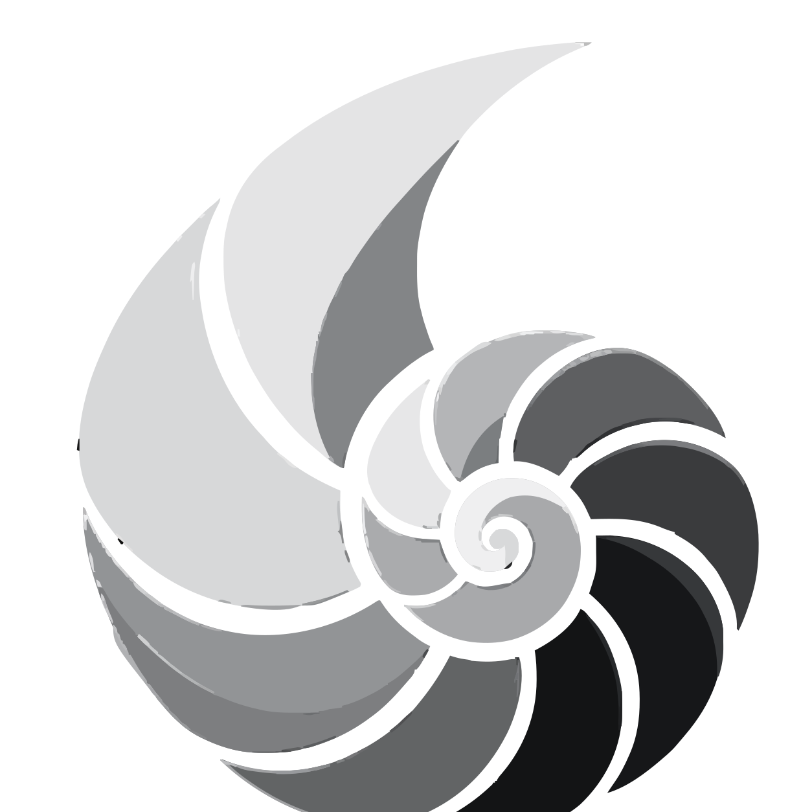

# Amonite CAD // High-Performance Browser-Based CAD/CAM Micro-SaaS

<p align="center">
  
</p>

<p align="center">
  <strong>Zero-auth, hardware-accelerated 3D viewport, precision measurement calipers, and client-side manufacturing interchange.</strong>
</p>

<p align="center">
  <a href="#key-features">Key Features</a> •
  <a href="#precision--measurement">Precision</a> •
  <a href="#tech-stack">Tech Stack</a> •
  <a href="#architecture-segregation">Architecture</a> •
  <a href="#quickstart">Quickstart</a> •
  <a href="#shortcuts">Shortcuts</a> •
  <a href="#community">Community</a> •
  <a href="#license">License</a>
</p>

---

## Overview

**Amonite** is an industrial-grade, client-side CAD workspace for mechanical
engineers, industrial designers, additive-manufacturing technicians, and digital
fabricators. No registration, no telemetry — geometry, transforms, and file
parsing all run locally in the browser.

## Key Features

- **Hardware-accelerated 3D viewport:** Three.js WebGL with orbit + transform
  gizmos, studio lighting, and XYZ axis reference.
- **Projection + render modes:** Perspective / orthographic cameras; shaded /
  wireframe / hidden-line styles; ISO, top, front, right, bottom, back, left presets.
- **Parametric primitives:** Cuboid, cylinder, sphere, torus, cone, and 2D-polygon
  extrusions with a numeric inspector.
- **Manufacturing interchange (client-side):** STL binary/ASCII export, DXF R12
  ASCII import/export, SVG import/export, lossless Amonite native JSON.
- **Zustand high-frequency store:** Viewport, gizmo, and coordinate state isolated
  from React re-renders for fluid interaction.
- **Local persistence:** Debounced `localStorage` autosave with undo/redo history
  (`Ctrl+Z` / `Ctrl+Y`).

## Precision & Measurement

- **Adaptive snap grid:** Divisions derive from `gridSize / snapStep`
  (`src/lib/grid-utils.ts`), clamped to 10–100 cells; steps selectable at
  1 / 5 / 10 / 25 mm.
- **Canonical-mm units:** Storage stays in millimeters; the HUD, inspector, and
  snap labels convert via `src/lib/measurement.ts` (`mm`, `cm`, `m`, `in`).
  Toggle `MM ⇄ IN` in the viewport bar.
- **Calipers (`M` / `Esc`):** Capture points A/B from the live cursor raycast,
  render a session-only 3D line, and report distance, ΔX/ΔY/ΔZ, and XY-plane angle.
- **HUD telemetry:** Live X/Y/Z cursor readout in the active unit plus snap status.

## Tech Stack

- **Framework:** Next.js 16 (App Router)
- **Language:** TypeScript 5 (strict)
- **Styling:** Tailwind CSS 4, industrial dark theme
- **3D:** Three.js (`three`, `@react-three/fiber`, `@react-three/drei`)
- **State:** Zustand
- **Icons:** Lucide React
- **Fonts:** Outfit + JetBrains Mono

## Architecture Segregation

Public core (`amonite`):

- Included: WebGL canvas, primitives, gizmos, calipers, parsers, `/docs`,
  waitlist funnel, local persistence.
- Excluded (private vault): auth, billing, server DB schemas, multi-tenant cloud
  sync, enterprise CAM post-processors.

## Quickstart

### Prerequisites

- Node.js 18+ (tested on Node 20/24)
- npm 9+

### Setup & Run (PowerShell)

```powershell
npm install
npm run dev
```

Open [http://localhost:3000](http://localhost:3000) (landing + live hero) or
[http://localhost:3000/sandbox](http://localhost:3000/sandbox) (fullscreen studio).

### Validation

```powershell
npx tsc --noEmit; if ($?) { npm run lint }; if ($?) { npm run build }
```

## Interactive Hotkeys

| Shortcut | Description |
| :--- | :--- |
| `V` | Select tool |
| `G` / `R` / `S` | Translate / rotate / scale gizmo |
| `M` | Toggle measurement calipers |
| `Esc` | Clear measurement / close calipers |
| `Ctrl+Z` / `Ctrl+Y` | Undo / redo |
| `Ctrl+D` | Duplicate selected entity |
| `Delete` | Delete selected entity |

## Community

- Code of conduct: [`CODE_OF_CONDUCT.md`](./CODE_OF_CONDUCT.md)
- Support / early access: `amoniteadmin@gmail.com` (also via in-app waitlist)

---

© Amonite CAD. Distributed under the MIT Open Source License.
