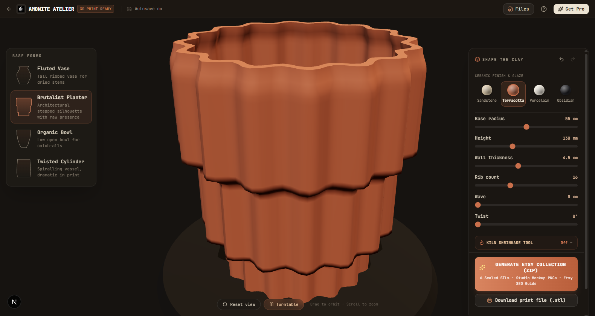
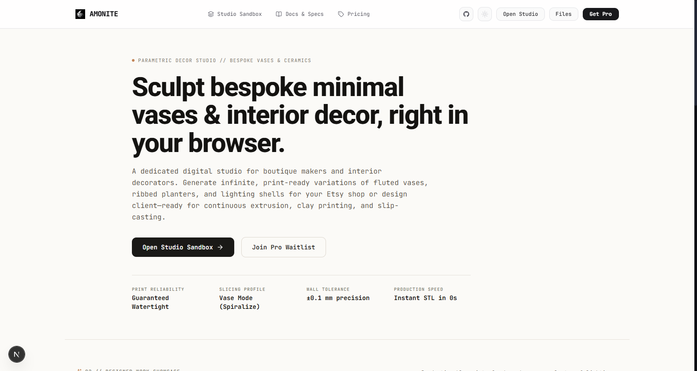
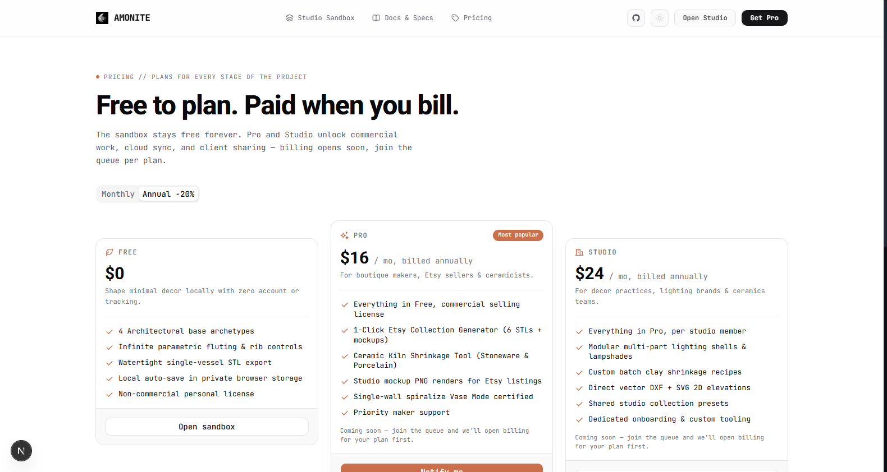

# Amonite // Minimalist 3D Vessel & Ceramic Studio

<p align="center">
  
</p>

<p align="center">
  <strong>Sculpt bespoke minimal vases, fluted ceramics, and interior decor directly in your browser.</strong><br />
  Zero account required. Zero telemetry. Guaranteed watertight, 3D-print-ready solids with kiln shrinkage compensation.
</p>

<p align="center">
  <a href="#the-studio">The Studio</a> •
  <a href="#key-capabilities">Capabilities</a> •
  <a href="#screenshots">Screenshots</a> •
  <a href="#ceramic--print-standards">Ceramic & Print Standards</a> •
  <a href="#tech-stack">Tech Stack</a> •
  <a href="#quickstart">Quickstart</a> •
  <a href="#studio-controls">Controls</a> •
  <a href="#license">License</a>
</p>

---

## The Studio

**Amonite** is a client-side 3D atelier engineered for interior decorators, ceramicists, and boutique 3D printing artisans. Instead of overwhelming CAD trees, measurement calipers, and engineering constraint solvers, Amonite provides a quiet, tactile workspace centered entirely around the ceramic vessel.

Every parameter—from wall thickness and rib fluting to organic waves and spiral twist—operates live at 60 FPS in WebGL, compiling directly into watertight, slicer-certified geometry ready for clay, resin, or single-wall spiralize Vase Mode 3D printing.

---

## Screenshots

### 1. The 3D Atelier & Tactile Sliders
*Full-bleed 3D viewport featuring the Brutalist Planter in raw Terracotta glaze, live parametric fluting sliders, kiln shrinkage presets, and the 1-Click Etsy Collection generator.*

<p align="center">
  
</p>

### 2. Editorial Gallery & Landing
*Clean, distraction-free entry designed for interior designers and boutique makers.*

<p align="center">
  
</p>

### 3. Maker Tiers & Commercial Licensing
*Transparent tiers crafted for independent makers, ceramic studios, and design agencies.*

<p align="center">
  
</p>

---

## Key Capabilities

- **Single-Vessel Atelier:** Isolated 3D stage with soft architectural gallery lighting, contact shadow plane, and refined studio plinth.
- **Architectural Archetypes:**
  - **Fluted Vase:** Tall ribbed silhouette tuned for dried botanical stems.
  - **Brutalist Planter:** Stepped, architectural profile with prominent weight.
  - **Organic Bowl:** Low, sweeping open vessel for centerpieces and catch-alls.
  - **Twisted Cylinder:** Spiralling geometric profile with dynamic shadow interplay.
- **Physical Glazes & Finishes:** Instant material preview in Bisque Sandstone, Raw Terracotta, Gloss Porcelain, and Matte Obsidian.
- **Kiln Shrinkage Tool:** Real-time geometric scale compensation for ceramic firing:
  - Terracotta: `+9.5%`
  - Stoneware: `+11.8%`
  - Porcelain: `+14.2%`
- **1-Click Etsy Batch Drop:** Generates an instant `.zip` containing 6 scaled watertight STLs (100mm to 350mm), studio-lit mockup PNGs, and pre-formatted Etsy listing SEO tags.
- **Single-Wall Spiralize Certified:** Geometries are strictly non-self-intersecting and manifold, guaranteed to print seamlessly in slicer Vase Mode with zero retractions.
- **Zero-Auth Privacy:** 100% client-side WebGL calculations. State autosaves to private local storage (`localStorage`) with full `Ctrl+Z` / `Ctrl+Y` history coalescing.

---

## Ceramic & Print Standards

| Standard | Specification | Behavior |
| :--- | :--- | :--- |
| **Mesh Manifoldness** | 100% Watertight (2-manifold) | Direct slice in Bambu Studio, PrusaSlicer, Cura with 0 repair warnings |
| **Vase Mode Support** | Single continuous contour perimeter | Zero seam line, zero retractions when spiralize outer contour is enabled |
| **Wall Thickness** | Parametric `1.5 mm` – `12.0 mm` | Tailored for 0.4mm–0.8mm FDM nozzles or ceramic paste extrusion |
| **Kiln Shrinkage** | Automatic dimension up-scaling | Compensates for greenware-to-bisque water loss before clay firing |
| **Export Formats** | Binary STL, 2D Vector DXF, SVG | Precision manufacturing and elevation drawings |

---

## Tech Stack

- **Framework:** Next.js 16 (App Router with TurboPack)
- **Language:** TypeScript 5 (Strict Mode)
- **Styling:** Tailwind CSS 4, warm architectural atelier theme (`#161310` stage, `#c96f4b` terracotta clay accent)
- **3D Engine:** Three.js (WebGL with PCF shadow mapping and ACES Filmic tone mapping)
- **State Management:** Zustand (high-frequency slider drag isolation and coalesced undo/redo history)
- **Components:** shadcn / Base UI with Remix Icons
- **Typography:** Outfit (Display) & JetBrains Mono (Technical HUD)

---

## Quickstart

### Prerequisites

- Node.js 20+ (or Node 18 LTS)
- npm 9+

### Setup & Development

```bash
# Clone the repository
git clone https://github.com/jhaabhijeet864/amonite.git
cd amonite

# Install dependencies
npm install

# Start local studio
npm run dev
```

Visit [http://localhost:3000](http://localhost:3000) for the gallery or [http://localhost:3000/sandbox](http://localhost:3000/sandbox) for the 3D atelier.

### Quality & Test Suite

```bash
# Typecheck
npx tsc --noEmit

# Lint
npm run lint

# Vitest Suite (Tier 1 unit + Tier 2 app routes)
npm test
```

---

## Studio Controls

| Interaction | Action |
| :--- | :--- |
| **Left Click + Drag** | Orbit around the ceramic vessel |
| **Right Click + Drag** | Pan across the studio stage |
| **Scroll Wheel** | Smooth zoom toward / away from the piece |
| **Reset View** | Re-center and frame the active vessel on the plinth |
| **Turntable Toggle** | Start / stop automated 360° studio rotation |
| **Parametric Sliders** | Real-time shape adjustment (radius, height, wall thickness, ribs, wave, twist) |
| **Ctrl + Z / Ctrl + Y** | Undo / Redo shape modifications |

---

## Architecture Segregation

This repository is strictly zero-auth and zero-database with no external telemetry. All geometry generation, WebGL rendering, STL file packing, and project file parsing execute entirely inside the client's browser.

---

## License

Distributed under the MIT Open Source License. Crafted for independent designers, ceramicists, and makers.
